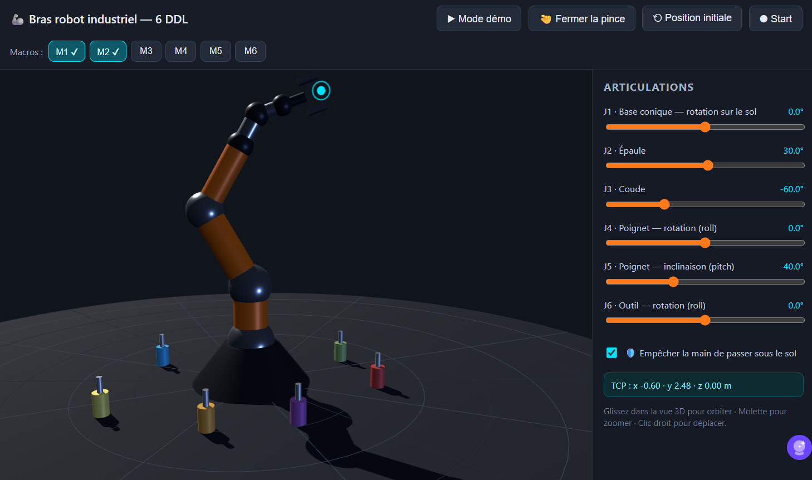

# Bras robot industriel 6 DDL

Application web 3D (Three.js) représentant un bras robot industriel à 6 degrés de liberté.


## Lancer l'application

```bash
cd bras-robot-6ddl
npm install        # installe three.js en local
npm start          # sert le site sur http://localhost:8080
```

Ouvrir ensuite http://localhost:8080 dans un navigateur.

## Fonctionnalités

- **Vue 3D manipulable** : orbite (glisser), zoom (molette), panoramique (clic droit) via OrbitControls.
- **6 curseurs** : un par degré de liberté, avec limites d'angle réalistes et valeur affichée en degrés.
- **Mode démo** : animation cyclique du robot entre plusieurs poses (bouton « ▶ Mode démo »), avec tracé de la trajectoire du TCP (outil). En mode démo, la pince saisit/lâche automatiquement les objets proches.
- **Pince ouvrable** : bouton « 🤏 Fermer la pince / ✋ Ouvrir la pince » ; la pince attrape la poignée d'un objet proche du TCP quand elle se ferme et le transporte, puis le lâche à l'ouverture.
- **6 objets à poignée** posés au sol autour du robot ; la poignée ciblée est surlignée en cyan.
- **Enregistrement de macros** : bouton « ⏺ Start / ⏹ Stop » mémorise tous les mouvements des curseurs (60 échantillons/s) ; à l'arrêt, la macro est « en attente » et un clic sur un bouton **M1–M6** la sauvegarde dans ce slot (✔). Un clic sur un bouton M1–M6 avec une macro enregistrée la **rejoue** intégralement.
- **Protection sol** : case « 🛡️ Empêcher la main de passer sous le sol » (activée par défaut) — toute pose qui ferait descendre le TCP sous 5 cm du sol est refusée et la pose précédente est restaurée.
- **Lecture TCP** : position 3D de l'effecteur (TCP) en temps réel.
- Bouton « ⟲ Position initiale » pour revenir à la pose de repos.

## Structure

- `index.html` — page et import map
- `css/style.css` — interface
- `js/kinematics.js` — définition des 6 articulations, limites, poses de la démo, logique d'animation
- `js/robot3d.js` — construction du modèle 3D hiérarchique (6 groupes d'articulations imbriqués)
- `js/main.js` — scène Three.js, contrôles, curseurs, boucle d'animation
- `test/` — tests Node (`npm test`) : cinématique, limites, poses de démo, géométrie du TCP
